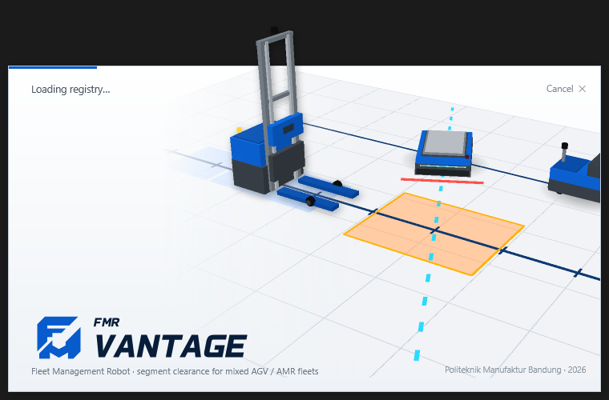
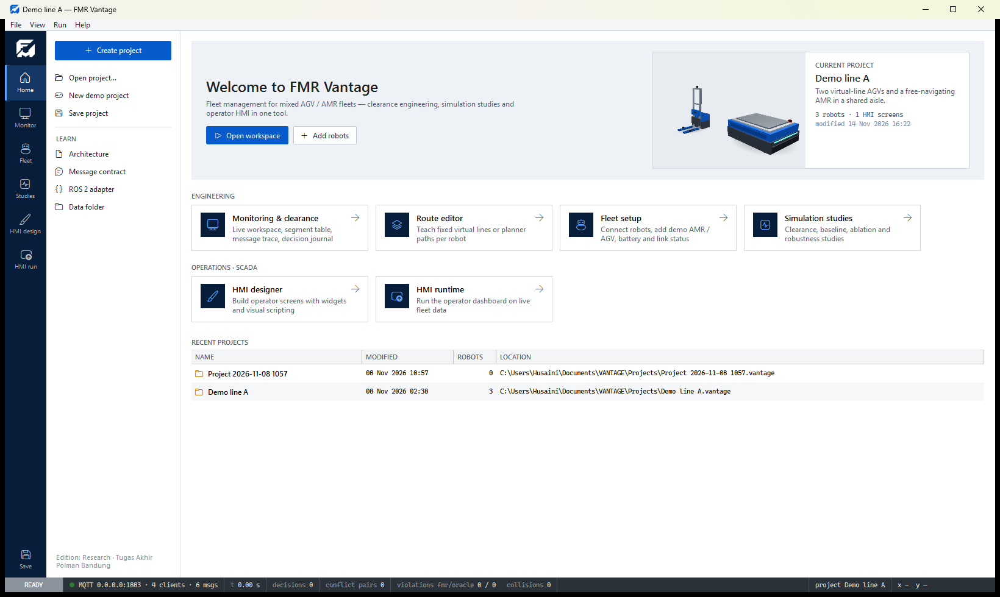
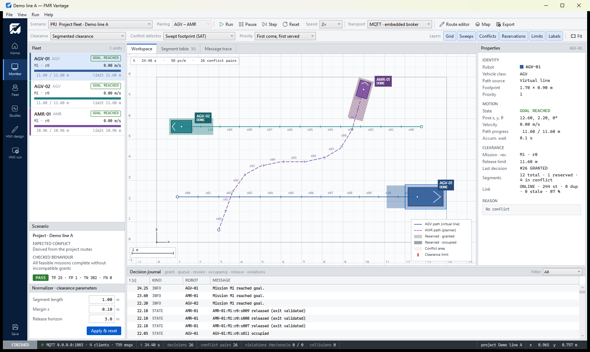
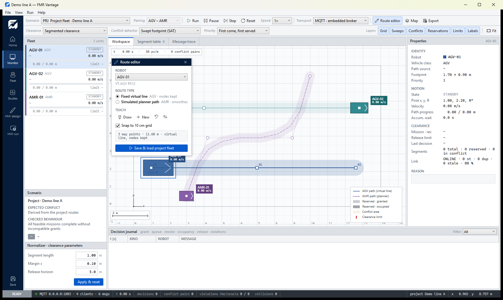
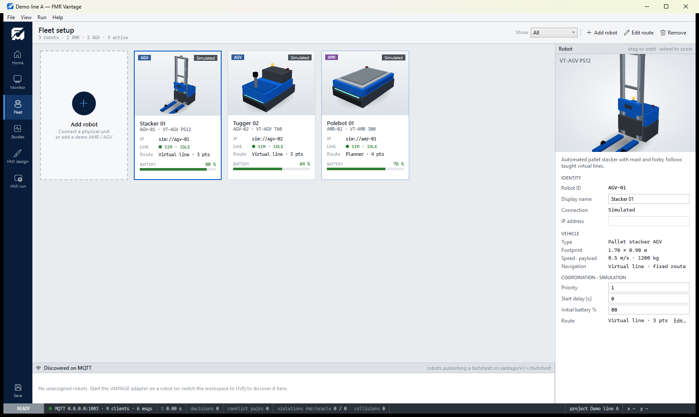
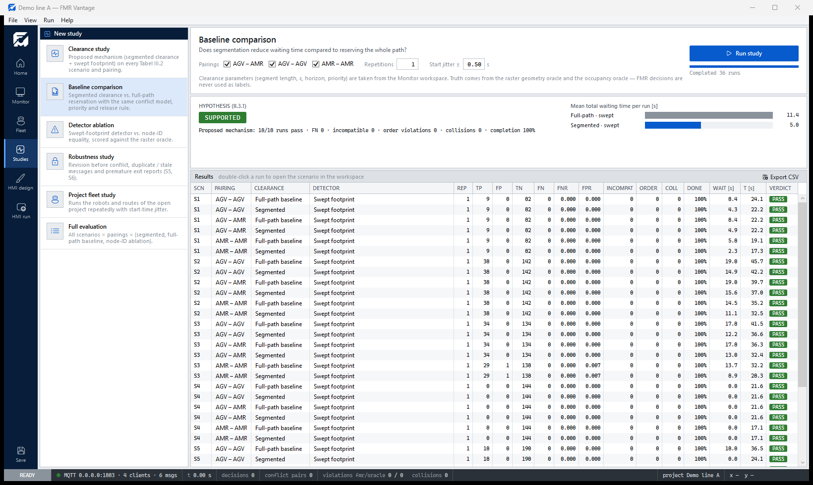
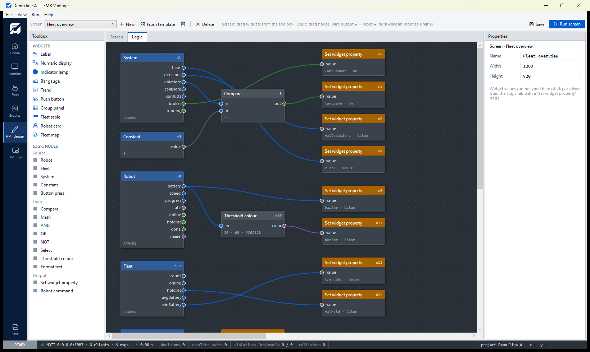
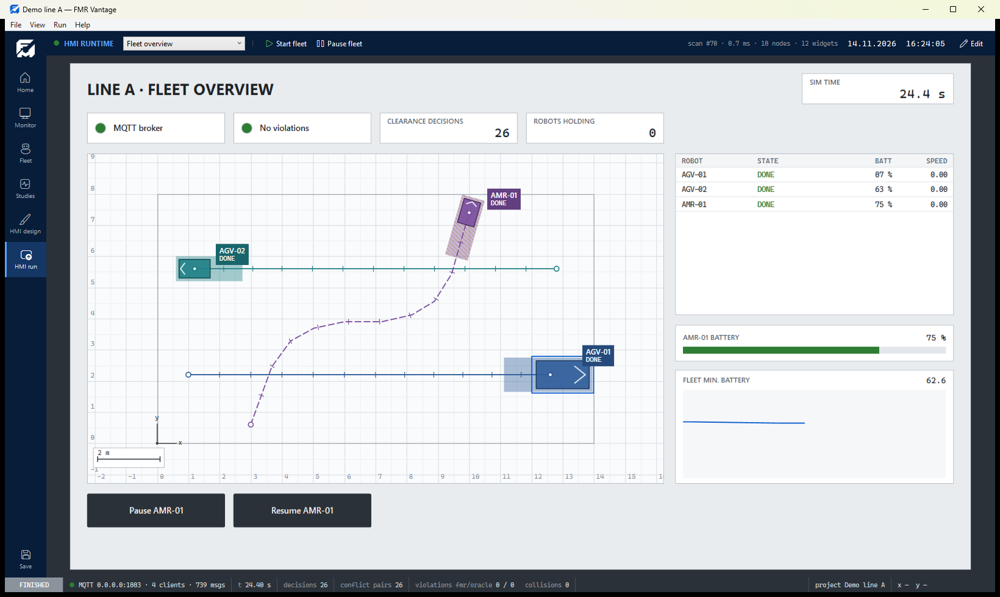

<p align="center">
  
</p>

<p align="center">
  <b>Fleet Management Robot dengan mekanisme clearance segmen konflik<br>untuk armada campuran AGV berpemandu jalur tetap dan AMR bernavigasi bebas</b><br>
  Tugas Akhir D4 · Teknologi Rekayasa Informatika Industri · Politeknik Manufaktur Bandung
</p>

<p align="center">
  
</p>

---

## Ringkasan

**FMR Vantage** adalah aplikasi Fleet Management Robot (FMR) end-to-end untuk Windows. Aplikasi ini mengatur siapa yang boleh memasuki bagian jalur yang dipakai bersama oleh beberapa robot. Izin itu disebut **clearance**, dan keputusannya diambil dari geometri sapuan footprint robot, bukan dari kesamaan ID node atau perkiraan waktu.

Isinya sekaligus:

* **Purwarupa penelitian.** Normalisasi jalur AGV/AMR ke satu kontrak segmen, deteksi konflik geometris, mesin keadaan clearance, oracle independen, dan studi simulasi untuk mengumpulkan bukti Bab IV.
* **Software operasional.** Broker MQTT tertanam, setup fleet, editor rute, monitoring live, serta HMI/SCADA yang bisa dirancang sendiri dengan widget dan visual scripting.

| Kebutuhan | Pendekatan di FMR Vantage |
|---|---|
| Dua sumber jalur (AGV virtual line & AMR planner) | Satu `PathNormalizer`: segmen berarah, geometri asal dipertahankan, identitas revisi |
| Deteksi konflik (Pers. II.2–II.3) | Irisan area sapuan footprint + margin ε (SAT), dibandingkan dengan oracle raster independen |
| Grant & release (Pers. III.1, Tabel II.1) | `ClearanceManager`: Menunggu → Diizinkan → Ditempati → Selesai / Direvisi, grant atomik per blok konflik |
| Pelepasan reservasi | Hanya jika progres lewat **dan** footprint + ε pada pose aktual sudah keluar dari area konflik, bukan berdasarkan timeout |
| Revisi, pesan duplikat/usang | Izin revisi lama dicabut (`REVOKED`), state dengan sequence lama dibuang, segmen yang sedang ditempati tetap direservasi |
| Komunikasi | MQTT `vantage/v1` yang dipetakan ke VDA 5050 3.0 bila ada padanannya (lihat [kontrak pesan](docs/MESSAGE_CONTRACT.md)) |

---

## Tampilan

### Home


### Monitoring & clearance
Workspace live: area sapuan per status reservasi, area konflik (arsir), garis STOP (batas clearance), footprint robot, tabel segmen, trace MQTT, dan journal keputusan.



### Route editor
Mengajarkan rute per robot langsung di workspace: **fixed virtual line** (AGV, node dipertahankan) atau **simulated planner path** (AMR, dihaluskan).



### Fleet setup
Kartu robot dengan render 3D, IP, status link, dan baterai. Robot fisik bisa ditambahkan dengan ID MQTT dan IP, atau robot demo dari katalog (AMR compact, AMR heavy, AGV pallet stacker, AGV tugger). Robot yang mengirim factsheet ke broker otomatis muncul di bagian *Discovered*.



### Simulation studies
Studi bergaya CAD (clearance, baseline jalur penuh, ablasi node-ID, robustness, project fleet, full evaluation), dengan verdict hipotesis, grafik, dan ekspor CSV.



### HMI designer (SCADA)
Layar operator disusun seperti form designer (lamp, numeric, bar, trend, button, fleet table, robot card, fleet map). Logikanya dibuat dengan **node graph**: Source → Logic → Output.



### HMI runtime
Layar operator berjalan dengan scan 200 ms pada data live; tombol bisa mengirim perintah `pause` / `resume` ke robot.



---

## Hasil uji (simulasi, Tabel III.2)

Enam skenario uji, masing-masing dijalankan untuk pasangan AGV–AMR, AGV–AGV, dan AMR–AMR. Kebenaran diambil dari **oracle geometri raster** dan **oracle okupansi** (pose sebenarnya dari simulator); keputusan FMR tidak pernah dipakai sebagai label.

| Skenario | Yang diperiksa |
|---|---|
| S1 Persilangan tengah edge | izin tidak aktif bersamaan; node-ID tidak mendeteksi |
| S2 Koridor berlawanan arah | robot kedua menunggu sampai koridor kosong |
| S3 Penggabungan jalur | urutan masuk & pelepasan konsisten |
| S4 Jalur dekat tidak beririsan | tidak tertahan tanpa alasan geometri |
| S5 Revisi sebelum area konflik | izin revisi lama tidak berlaku |
| S6 Pesan duplikat / usang / keluar prematur | tidak ada grant/release ganda |

Hasil baseline comparison (18 run per konfigurasi):

| Konfigurasi | Lulus | FN | Izin tidak kompatibel | Pelanggaran urutan | Tabrakan | Rata-rata waktu tunggu |
|---|---|---|---|---|---|---|
| **Segmented clearance (usulan)** | **18/18** | 0 | 0 | 0 | 0 | **5.0 s** |
| Full-path reservation (baseline) | 18/18 | 0 | 0 | 0 | 0 | 11.4 s |
| Node-ID equality (ablasi) | gagal di skenario persilangan | > 0 | > 0 | — | > 0 | — |

Ablasi node-ID sengaja disertakan untuk menunjukkan bahwa kesamaan ID node saja tidak cukup: persilangan di tengah edge terlewat dan menimbulkan tabrakan.

---

## Menjalankan

### Demo (tanpa install)
Unduh build demo, lalu jalankan `FMRVantage.exe`. Build ini self-contained karena runtime .NET 10 sudah ada di dalamnya.

```powershell
.\FMRVantage.exe                                     # splash → Home
.\FMRVantage.exe --page monitor --scenario PRJ --run # langsung demo fleet
.\FMRVantage.exe --demo                              # proyek demo di memori, tidak menyimpan apa pun
```

Shortcut Desktop dapat dibuat dengan `tools/create-shortcuts.ps1`.

### Dari source
Kebutuhan: Windows 10/11 dan [.NET 10 SDK](https://dotnet.microsoft.com/download/dotnet/10.0) (`tools/setup-dotnet.ps1` memasang SDK per-user tanpa admin).

```bash
dotnet build Vantage.slnx
dotnet test tests/Vantage.Core.Tests
dotnet run --project src/Vantage.Studio
```

Build demo self-contained:

```bash
dotnet publish src/Vantage.Studio -c Release -r win-x64 --self-contained true -p:PublishSingleFile=true -p:IncludeNativeLibrariesForSelfExtract=true -p:EnableCompressionInSingleFile=true -p:DebugType=none -o dist/FMR-Vantage-0.1.0-win-x64
```

### Opsi command line

| Opsi | Arti |
|---|---|
| `--page home\|monitor\|fleet\|studies\|hmidesigner\|hmiruntime` | halaman awal |
| `--scenario PRJ \| S1…S6 \| LIVE` | skenario yang dimuat (`PRJ` = fleet proyek, `LIVE` = robot fisik) |
| `--run` | langsung jalan |
| `--speed 0.25…8` | faktor kecepatan simulasi |
| `--transport inproc` | bus in-process deterministik, bukan MQTT |
| `--routes` | buka route editor |
| `--study clearance\|baseline\|ablation\|robustness\|project\|full` | jalankan studi saat start |
| `--demo` | proyek demo di memori (presentasi) |
| `--no-splash` | lewati jeda splash |
| `--render-splash file.png` | simpan splash sebagai gambar lalu keluar |

Pintasan: F5 run · F6 pause · F10 step · Ctrl+R reset · Ctrl+S simpan · roda mouse zoom · drag pan · klik robot untuk memilih.

---

## Robot fisik (ROS 2)

`adapters/ros2/vantage_adapter.py` menghubungkan satu robot ke FMR. Adapter ini mengirim factsheet, path (Nav2 `/plan` atau virtual line), dan state (pose TF, progres, baterai), lalu menegakkan batas clearance dengan zero `Twist` lewat `twist_mux`. Lihat [adapters/ros2/README.md](adapters/ros2/README.md).

```bash
python3 vantage_adapter.py --ros-args -p robot_id:=AMR-01 -p vehicle_class:=AMR -p path_source:=planner -p broker_host:=192.168.137.1
```

> Adapter sudah dicek sintaksnya, tetapi belum diuji pada robot fisik.

---

## Struktur repositori

```
src/
  Vantage.Core/      geometri (SAT, footprint, area sapuan), normalizer, detektor konflik + oracle, ClearanceManager
  Vantage.Fleet/     kontrak MQTT, broker tertanam, coordinator, simulator, skenario, katalog robot, proyek, mesin HMI
  Vantage.Studio/    aplikasi WPF FMR Vantage (Home, Monitor, Fleet, Studies, HMI designer/runtime)
tests/Vantage.Core.Tests/   28 uji: geometri, clearance, skenario Tabel III.2, HMI, proyek
adapters/ros2/       adapter ROS 2 ↔ MQTT
docs/                arsitektur, kontrak pesan, branding, screenshot
tools/               setup SDK, shortcut demo
FMR.AisinAMR/        purwarupa awal (magang) sebagai referensi
```

Dokumentasi: [Arsitektur](docs/ARCHITECTURE.md) · [Kontrak pesan vantage/v1](docs/MESSAGE_CONTRACT.md) · [Branding](docs/branding/logo-concept-02/README.md)

---

<sub>Muhamad Hafizh Husaini · Politeknik Manufaktur Bandung · 2026</sub>
